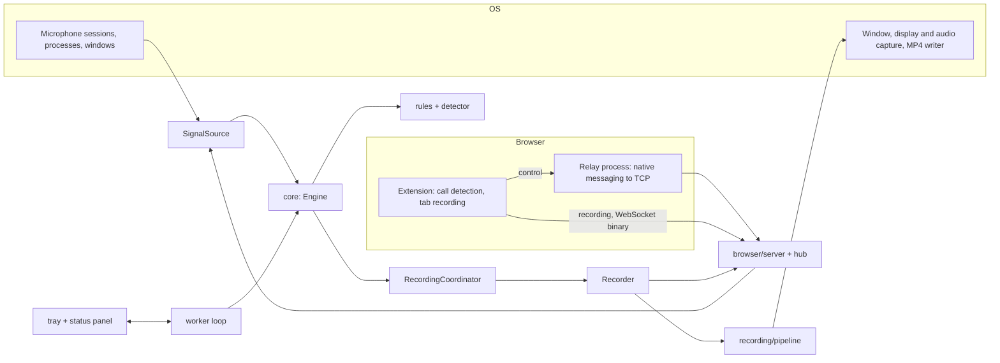

# Meeting Assistant architecture

This page is for people who change the code. It says which part owns which responsibility, what each part may depend on, and what the tests do and do not establish. [Product](PRODUCT.md) owns the behavior a user can rely on; the [designs](docs/design/) own the contracts of each boundary; the [ADRs](docs/adr/) own the reasons.

## Structural principle

Code that decides what to do is separated from code that touches the world. Decisions are pure functions or types that depend only on ports (traits). Files, the clock, threads, sockets and operating system APIs sit behind those ports. Each port has a real adapter and a fake, and the deciding code is tested with the fake.

Platform code is kept to small operations such as "read which processes use the microphone" or "copy this file". Procedures and policy live on the shared side and are written once. The [effect boundaries design](docs/design/design-effect-boundaries.md) states the rule, and [ADR: ports, adapters and fakes](docs/adr/adr-20261117-ports-adapters-fakes.md) the reason.

## Overall structure

One process hosts the tray UI on the main thread, an engine thread that polls signals and drives the coordinator, one recorder thread per recording, and a listener plus one thread per extension connection. When the browser starts the same executable as a native-messaging host, it runs only as a relay between the browser's standard input/output and the resident app's loopback socket.

## Workspace

| Path | Responsibility |
| --- | --- |
| `crates/core` | Operating-system-independent decisions. Reaches the outside world only through ports |
| `crates/app` | The `meeting-assistant` executable: adapters, platform code, composition, UI |
| `extension` | Chrome/Edge MV3 extension: call detection and tab recording. Embedded in the executable and written out at install time |
| `tools/tabcapture-probe` | A throwaway extension used once to verify that the browser switch permits tab capture without a user gesture |
| `tools/avsync` | A Windows tool, outside the workspace, that measures how far sound and picture are apart in a recording of the screen |

## Component ownership

### `crates/core`

| Module | Responsibility |
| --- | --- |
| `rules` | `MeetingRule`, the default rules, and `RuleEvaluator`: given a signal snapshot, which rule is satisfied and by which process and window. Pure |
| `apps` | `MeetingApp`, the port through which an adapter for one meeting app tells what each of its windows is (main, a meeting's, or unknown), and `WindowRole`. Pure |
| `metadata` | `MeetingMetadata`, what is known of a meeting besides its app (keys and values per app, kept by one set of rules), and `RecordingMetadata`, what is written into a recording: the app, its start and the meeting's metadata. Pure |
| `detector` | `MeetingDetector`: start debounce and end grace over a sequence of evaluations, which window is a meeting's, and what is learned of each meeting (reported as `Updated`). Pure; time is passed in |
| `coordinator` | `RecordingCoordinator`: turns meeting starts, ends and manual commands into recorder calls; chooses the video target and audio process; retries after failure; names the file |
| `engine` | `Engine`: one tick = capture signals, evaluate, update the detector, tell the coordinator; returns state and notices |
| `naming` | Recording file names and collision handling. Pure |
| `config` | `Config`: the file's format version, TOML parsing, defaults and validation. Pure; reading the file, and replacing one of another version with the defaults, is an adapter's job |
| `signals`, `recording`, `ports` | The ports and their value types: `SignalSource`, `Recorder`, `Clock`, `OutputFolder`, `Pause` |
| `fakes` | Fakes for every core port, behind the `fakes` feature |

### `crates/app`

| Module | Responsibility |
| --- | --- |
| `cli` | Argument parsing into an `Invocation`. Pure |
| `install` | The install, update and uninstall procedures, written against the `InstallSystem` port |
| `recording/plan` | From a request and configuration: the video source, the two audio tracks (other side, microphone) with the source of each, and the output format; also the plan for the microphone alone. Pure |
| `recording/fit` | Where a captured picture goes on the fixed canvas, for the Windows scaler: copied whole, cropped by the pixel an odd size loses, scaled down when larger, or centered at its own size when smaller. Pure |
| `recording/timeline` | Frame and audio timestamps and pacing. Pure |
| `recording/mixer` | Buffering each 16-bit PCM source against jitter and delay. Pure |
| `recording/pipeline` | How one recording proceeds: open, first picture, write loop with one audio block per track, retarget, finalize. Uses `CaptureBackend`, `Pacer` and `Control` |
| `recording/session` | `ThreadedRecorder`: runs a pipeline on its own thread and presents it as a core `Recorder` and as the `MicrophoneRecorder` used beside a tab recording |
| `recording/merge` | Where the microphone recorded beside a tab recording goes on its timeline, and the procedure that adds it as the second audio track and keeps both files on failure. Uses `Remuxer` and `RecordingFiles` |
| `recording/mp4` | Adds a track, read from an ordinary or a fragmented MP4, to a fragmented MP4 by rewriting its `moov` and appending fragments, copying every sample of the original fragments; writes QuickTime metadata into any MP4's `moov`. Either way the offsets that point past the `moov` move with it. Reads through `ReadAt`. Pure |
| `recording/annotate` | The keys written into a finished recording (`com.meeting-assistant.app`, `started_at`, `meeting.<key>`) and the procedure that writes them beside it and puts the result in its place, leaving the recording as it was on failure. Uses `Remuxer` and `RecordingFiles` |
| `browser/protocol` | Message types and length-prefixed framing shared with the extension. Pure apart from generic `Read`/`Write` |
| `browser/hub` | State machine of extension connections, reported meetings and the single tab recording and its upload. Writes data to a `ChunkSink`; touches no socket or file |
| `browser/server`, `endpoint`, `relay` | The loopback control listener and the per-recording WebSocket upload listener, the published endpoint file, and the relay the browser launches |
| `linked` | `LinkedSignalSource` and `LinkedRecorder`: combine the OS path and the extension path behind the core ports, using `BrowserPort`; every recording that finishes or fails gets its metadata written here, the same way whichever path made it |
| `worker` | The loop that ticks the engine at the poll interval and handles commands from the UI |
| `panel/view` | What the status panel and the tray icon show, the tooltip and running time, what the panel's messages ask for, and where the panel goes next to the icon. Pure |
| `panel/window`, `panel/panel.html` | The panel's borderless window and the self-contained page that the system web view (`wry`) shows in it. One page for both platforms; it follows the macOS or the Windows 11 design through a mark the platform gives it |
| `apps` | The `MeetingApp` adapters, one per app that more is known about (Slack: the mark it puts in its main window's title while a joined huddle is open). Pure; given to the engine in `composition` |
| `adapters` | Real implementations of the core ports (system clock, recordings folder, sleeping, configuration file) and of the merge's ports (`Mp4Remuxer`, files) |
| `platform/win`, `platform/mac` | The only modules that call operating system APIs |
| `composition`, `tray`, `main`, `diagnostics`, `logging`, `bundle` | Wiring of real implementations, the tray UI, entry point, `--probe`/`--self-test`, the log file, embedded extension files |

### What platform code owns

| Platform item | Small operations it provides |
| --- | --- |
| `PlatformSignalSource` | Processes with an active capture session, the process tree, the list of top-level windows, default device state |
| `PlatformRecorder` | A `CaptureBackend`: open a window or display capture, take a picture, scale it, open audio inputs, write and finalize the file |
| `PlatformLoopbackPeers` | A `LoopbackPeers`: the user that owns the other end of a loopback connection, and the user the app runs as. The browser listeners admit only the current user's connections ([ADR](docs/adr/adr-20261118-admit-loopback-connections-only-from-the.md)) |
| `PlatformInstaller` | An `InstallSystem`: copy and remove files, registry or plist entries, native-host registration, shortcuts or launcher apps |
| Other | Single-instance guard, quit requests, session-end notification, toasts and dialogs, the status panel's window style (the system material behind a transparent page and rounded corners: the popover material on macOS, the acrylic of flyouts on Windows), the accent color, how the tray icon follows the menu bar or the taskbar and whether text can be shown next to it, what the event loop needs before it runs, whether the screen can be recorded |

On Windows these use WASAPI session enumeration, Windows.Graphics.Capture, the Direct3D 11 video processor (which scales and crops each picture and converts it to NV12 in one pass), WASAPI process loopback and the Media Foundation sink writer. NV12 is what every H.264 encoder takes, so the sink writer can use the hardware encoder of any GPU vendor, or Windows' software encoder; nothing in the app names a vendor. The capture is asked for no more pictures than are written, the pictures are drawn into a few textures that are reused once the encoder lets go of them (the sink writer gets tracked samples), and audio inputs wake when WASAPI signals sound rather than on a timer. On macOS they use Core Audio process objects, libproc and CGWindowList for signals; ScreenCaptureKit for window, display and app-audio capture (the system scales pictures to the recording's size); AVAudioEngine for the microphone; and AVAssetWriter for the file. Float audio is converted and resampled by the pure `recording::pcm`. [The macOS capture ADR](docs/adr/adr-20261118-capture-on-macos-with-screencapturekit-a.md) records why.

## Detection and recording flow

1. `worker` calls `Engine::tick` once per poll interval.
2. The engine reads through `LinkedSignalSource` what the tick needs: the microphone's sessions and the extension's connections and reported meetings every time, the playback sessions, the process tree and the windows only while some process uses the microphone or an app's meeting is recorded.
3. `RuleEvaluator` evaluates each rule. A browser process that has a connected extension is left to the extension.
4. `MeetingDetector` applies the debounce and grace period to each meeting separately and reports its starts and ends.
5. `RecordingCoordinator` keeps the detected meetings, picks the one to record automatically, and builds a `RecordingRequest` (output path, `VideoTarget`, audio process) and calls `Recorder::start` or `stop`. While recording it retargets the window when the recorded one disappears, and collects failures with `take_failure`.
6. `LinkedRecorder` sends a `VideoTarget::BrowserTab` request to the extension and every other target to the platform recorder.

The [meeting detection design](docs/design/design-meeting-detection.md) holds the contract.

## Status panel

`worker` publishes the coordinator's status on every change. `tray` keeps the latest one and hands it to `panel::view`, which produces the tray's texts and the panel's content as JSON; `tray` has no platform branches and asks `platform` how the icon and the running time are shown; the page renders it and posts the user's clicks back as small JSON messages, which `panel::view` turns into worker commands. The page is embedded in the executable, loads nothing from elsewhere and cannot navigate. Thirty seconds after the panel closes the page is let go, which ends the web view's processes, most of the app's memory; opening the panel later loads it again. See [ADR: web-view status panel](docs/adr/adr-20261118-show-status-and-controls-in-a-web-view-p.md).

## Recording on the OS path

`ThreadedRecorder::start` spawns a thread, creates the backend inside it (capture objects are bound to the thread that creates them) and waits up to 20 seconds for the first picture. The pipeline then writes one video frame per frame interval and, one step later when it has been captured, that interval's block of each of the two audio tracks from the track's own source (or silence), using the timeline so that all carry the same clock. Audio captured while the recording was being prepared is dropped, and each input keeps only as much queued as mixing needs, so sound does not lag the picture. The canvas is `video.width` by `video.height` (1920x1080 by default and at most); every picture is fitted into it with its aspect ratio kept, so a window may change size or shape. The file is fragmented MP4, so what has been written stays playable if the process dies. See the [capture pipeline design](docs/design/design-capture-pipeline.md).

## Recording through the extension

`hook.js` runs in the page and observes `RTCPeerConnection` state; `bridge.js` forwards it to `background.js`, which reports meetings over native messaging. On a start command the background script opens the offscreen document, reads the tab's size and only then obtains a tab-capture stream ID, which `offscreen.js` uses at once to record the tab's video and audio with `MediaRecorder`; the browser refuses another capture of a tab while one is pending or running, so a failed start stops every captured track and closes the document. The recording does not go back through native messaging, which carries only JSON: `offscreen.js` opens a WebSocket to a loopback port the app opened for this recording and sends each one-second piece as a binary message, which the server appends to the file as it is. The relay carries only the control messages; the `Hub` keeps the state of both channels.

The browser does not let the extension's offscreen document use the microphone, so `LinkedRecorder` records it on the OS path: before it asks the extension to start, it starts a second `ThreadedRecorder` on the microphone-only plan, writing `<recording>.microphone.m4a`. The moment the upload proves itself is the tab recording's time zero. When the tab recording ends or fails, the microphone recording is stopped and `recording::merge` places it on the tab's timeline and has `recording::mp4` write the tab's file with the microphone as its second audio track. The tab's own fragments are copied byte for byte, because AVFoundation reads the browser's fragment timing differently from the file's `tfdt` and would move them. Then, as for every recording, `LinkedRecorder` has `recording::annotate` write the recording's metadata into the file.

The app listens on `127.0.0.1` at a random port and writes the port and a random token to `browser-link.json` in the user's local application data. The relay reads that file and must present the token first. The browser starts the relay only for the extension ID named in the native-host manifest. Each recording's upload listener is another loopback port with a one-time token sent in the start command; it accepts only the extension's `Origin` and closes once the upload has proved itself. See the [browser tab recording design](docs/design/design-browser-tab-recording.md) and [the protocol reference](docs/technical/browser-link.md).

## Correctness boundaries

- **Core has no effects.** `crates/core` does not use the file system, the clock, threads, environment or OS crates outside `fakes` and tests. `crates/core/tests/architecture.rs` reads the sources and fails on a forbidden dependency.
- **OS APIs stay in `platform`.** `crates/app/src/architecture.rs` fails if an OS crate (`windows`, `libc`, `signal_hook`, `notify_rust`, `window_vibrancy`) or a `tao` platform extension is used outside `platform`, if a deciding module (`cli`, `install`, `linked`, `worker`, `panel/view`, `browser/protocol`, `browser/hub`, `recording/plan`, `fit`, `timeline`, `mixer`, `pipeline`, `merge`, `annotate`, `mp4`, `apps`) touches files, sockets, processes, the environment or an adapter, or if the two platform implementations stop exposing the same names.
- **One recording at a time.** The coordinator holds at most one recording; the hub holds at most one tab recording.
- **Scope is never widened silently.** In app scope a missing window gives a black picture and a failed app-audio capture gives no app audio. Neither falls back to the display or the output device.
- **A started file is finalized.** Stop, drop of the recorder, quit, logoff and shutdown all reach `finalize`. On macOS a logout or a quit sent by another app ends the tray's event loop instead of sending a signal, so the tray also finalizes on the loop's last event. A recording that fails keeps its partial file.
- **Start reports the real outcome.** `Recorder::start` returns only after capture is running or has failed, so the coordinator never reports a recording that did not begin.
- **The extension link is local and authenticated.** Both listeners bind to loopback only. The control listener rejects a connection whose first message does not carry the token; before that, a connection is held to a small first message, a short deadline and a small number of waiting peers. An upload listener exists only while a recording starts and accepts only the extension's origin with that recording's token.
- **The app and the extension change together.** Neither keeps compatibility with older versions of the other; a control message the app cannot parse is logged and ignored.

## Verification boundary

Unit tests cover the pure modules and, through fakes, the coordinator, engine, pipeline, threaded recorder, hub, linked recorder, worker and install procedure. The architecture tests enforce the dependency rules above. The extension's `background.js` and `offscreen.js` are tested with Node's test runner against fakes of the browser's APIs (`extension/test`).

Tests do not exercise the real Windows adapters, the tray UI, the status panel's window and page, a real browser or a real meeting service. Those were checked by hand on one Windows 11 PC and on one Mac, where Slack huddles and Google Meet calls were recorded on 2026-11-19; [the Windows note](docs/note/note-20261117-local-verification.md), [the first macOS note](docs/note/note-20261118-macos-verification-2026-11-18.md), [the Slack huddle note](docs/note/note-20261119-slack-huddle-window-after-the-merge.md) and [the recording metadata note](docs/note/note-20261119-recording-metadata-verification.md) record what was observed. A passing test suite therefore does not establish that recording works on a given machine; `meeting-assistant --self-test` does that for the OS path.

The [development guide](docs/development.md) lists the commands, and [testing](docs/technical/testing.md) describes each suite.
