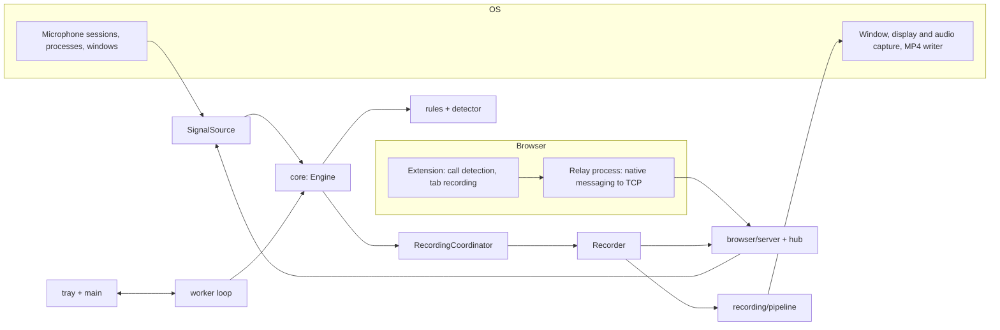

# Meeting Assistant architecture

This page is for people who change the code. It says which part owns which responsibility, what each part may depend on, and what the tests do and do not establish. [Product](PRODUCT.md) owns the behavior a user can rely on; the [designs](docs/design/) own the contracts of each boundary; the [ADRs](docs/adr/) own the reasons.

## Structural principle

Code that decides what to do is separated from code that touches the world. Decisions are pure functions or types that depend only on ports (traits). Files, the clock, threads, sockets and operating system APIs sit behind those ports. Each port has a real adapter and a fake, and the deciding code is tested with the fake.

Platform code is kept to small operations such as "read which processes use the microphone" or "copy this file". Procedures and policy live on the shared side and are written once. The [effect boundaries design](docs/design/design-effect-boundaries.md) states the rule, and [ADR: ports, adapters and fakes](docs/adr/adr-20261117-ports-adapters-fakes.md) the reason.

## Overall structure

One process hosts the tray UI on the main thread, an engine thread that polls signals and drives the coordinator, one recorder thread per recording, and a listener plus one thread per extension connection. When the browser starts the same executable as a native-messaging host, it runs only as a relay between the browser's standard input/output and the resident app's loopback socket.

## Workspace

| Path | Responsibility |
| --- | --- |
| `crates/core` | Operating-system-independent decisions. Reaches the outside world only through ports |
| `crates/app` | The `meeting-assistant` executable: adapters, platform code, composition, UI |
| `extension` | Chrome/Edge MV3 extension: call detection and tab recording. Embedded in the executable and written out at install time |
| `tools/tabcapture-probe` | A throwaway extension used once to verify that the browser switch permits tab capture without a user gesture |

## Component ownership

### `crates/core`

| Module | Responsibility |
| --- | --- |
| `rules` | `MeetingRule`, the default rules, and `RuleEvaluator`: given a signal snapshot, which rule is satisfied and by which process and window. Pure |
| `detector` | `MeetingDetector`: start debounce and end grace over a sequence of evaluations. Pure; time is passed in |
| `coordinator` | `RecordingCoordinator`: turns meeting starts, ends and manual commands into recorder calls; chooses the video target and audio process; retries after failure; names the file |
| `engine` | `Engine`: one tick = capture signals, evaluate, update the detector, tell the coordinator; returns state and notices |
| `naming` | Recording file names and collision handling. Pure |
| `config` | `Config`: TOML parsing, defaults and validation. Pure; reading the file is an adapter's job |
| `signals`, `recording`, `ports` | The ports and their value types: `SignalSource`, `Recorder`, `Clock`, `OutputFolder`, `Pause` |
| `fakes` | Fakes for every core port, behind the `fakes` feature |

### `crates/app`

| Module | Responsibility |
| --- | --- |
| `cli` | Argument parsing into an `Invocation`. Pure |
| `install` | The install, update and uninstall procedures, written against the `InstallSystem` port |
| `recording/plan` | From a request and configuration: which video and audio sources to open and the output format. Pure |
| `recording/timeline` | Frame and audio timestamps and pacing. Pure |
| `recording/mixer` | Mixing 16-bit PCM inputs. Pure |
| `recording/pipeline` | How one recording proceeds: open, first picture, write loop, retarget, finalize. Uses `CaptureBackend`, `Pacer` and `Control` |
| `recording/session` | `ThreadedRecorder`: runs a pipeline on its own thread and presents it as a core `Recorder` |
| `browser/protocol` | Message types and length-prefixed framing shared with the extension. Pure apart from generic `Read`/`Write` |
| `browser/hub` | State machine of extension connections, reported meetings and the single tab recording. Writes data to a `ChunkSink`; touches no socket or file |
| `browser/server`, `endpoint`, `relay` | Loopback listener, the published endpoint file, and the relay the browser launches |
| `linked` | `LinkedSignalSource` and `LinkedRecorder`: combine the OS path and the extension path behind the core ports, using `BrowserPort` |
| `worker` | The loop that ticks the engine at the poll interval and handles commands from the UI |
| `adapters` | Real implementations of the core ports: system clock, recordings folder, sleeping, configuration file |
| `platform/win`, `platform/mac` | The only modules that call operating system APIs |
| `composition`, `tray`, `main`, `diagnostics`, `logging`, `bundle` | Wiring of real implementations, the tray UI, entry point, `--probe`/`--self-test`, the log file, embedded extension files |

### What platform code owns

| Platform item | Small operations it provides |
| --- | --- |
| `PlatformSignalSource` | Processes with an active capture session, the process tree, the list of top-level windows, default device state |
| `PlatformRecorder` | A `CaptureBackend`: open a window or display capture, take a picture, scale it, open audio inputs, write and finalize the file |
| `PlatformInstaller` | An `InstallSystem`: copy and remove files, registry or plist entries, native-host registration, shortcuts or launcher apps |
| Other | Single-instance guard, quit requests, session-end notification, toasts and dialogs |

On Windows these use WASAPI session enumeration, Windows.Graphics.Capture, the Direct3D 11 video processor, WASAPI process loopback and the Media Foundation sink writer. On macOS only the installer, single-instance and signal handling exist; `PlatformRecorder` reports that capture is not implemented.

## Detection and recording flow

1. `worker` calls `Engine::tick` once per poll interval.
2. `LinkedSignalSource` captures a `SignalSnapshot` from the OS and adds the extension's connections and reported meetings.
3. `RuleEvaluator` evaluates each rule. A browser process that has a connected extension is left to the extension.
4. `MeetingDetector` applies the debounce and grace period and reports a start or an end.
5. `RecordingCoordinator` builds a `RecordingRequest` (output path, `VideoTarget`, audio process) and calls `Recorder::start` or `stop`. While recording it retargets the window when the recorded one disappears, and collects failures with `take_failure`.
6. `LinkedRecorder` sends a `VideoTarget::BrowserTab` request to the extension and every other target to the platform recorder.

The [meeting detection design](docs/design/design-meeting-detection.md) holds the contract.

## Recording on the OS path

`ThreadedRecorder::start` spawns a thread, creates the backend inside it (capture objects are bound to the thread that creates them) and waits up to 20 seconds for the first picture. The pipeline then writes one video frame and the matching block of mixed audio per frame interval, using the timeline so that both carry the same clock. The canvas size is fixed at start; later pictures are scaled into it. The file is fragmented MP4, so what has been written stays playable if the process dies. See the [capture pipeline design](docs/design/design-capture-pipeline.md).

## Recording through the extension

`hook.js` runs in the page and observes `RTCPeerConnection` state; `bridge.js` forwards it to `background.js`, which reports meetings over native messaging. On a start command the background script obtains a tab-capture stream ID, and `offscreen.js` records the tab and the microphone with `MediaRecorder` and sends one-second chunks back. The relay copies frames between the browser and the app's loopback socket; the `Hub` validates the sequence and the server appends the bytes to the file.

The app listens on `127.0.0.1` at a random port and writes the port and a random token to `browser-link.json` in the user's local application data. The relay reads that file and must present the token first. The browser starts the relay only for the extension ID named in the native-host manifest. See the [browser tab recording design](docs/design/design-browser-tab-recording.md) and [the protocol reference](docs/technical/browser-link.md).

## Correctness boundaries

- **Core has no effects.** `crates/core` does not use the file system, the clock, threads, environment or OS crates outside `fakes` and tests. `crates/core/tests/architecture.rs` reads the sources and fails on a forbidden dependency.
- **OS APIs stay in `platform`.** `crates/app/src/architecture.rs` fails if an OS crate (`windows`, `libc`, `signal_hook`, `notify_rust`) is used outside `platform`, if a deciding module (`cli`, `install`, `linked`, `worker`, `browser/protocol`, `browser/hub`, `recording/plan`, `timeline`, `mixer`, `pipeline`) touches files, sockets, processes, the environment or an adapter, or if the two platform implementations stop exposing the same names.
- **One recording at a time.** The coordinator holds at most one recording; the hub holds at most one tab recording.
- **Scope is never widened silently.** In app scope a missing window gives a black picture and a failed app-audio capture gives no app audio. Neither falls back to the display or the output device.
- **A started file is finalized.** Stop, drop of the recorder, quit, logoff and shutdown all reach `finalize`. On macOS a logout or a quit sent by another app ends the tray's event loop instead of sending a signal, so the tray also finalizes on the loop's last event. A recording that fails keeps its partial file.
- **Start reports the real outcome.** `Recorder::start` returns only after capture is running or has failed, so the coordinator never reports a recording that did not begin.
- **The extension link is local and authenticated.** The listener binds to loopback only and rejects a connection whose first message does not carry the token. Before that, a connection is held to a small first message, a short deadline and a small number of waiting peers.
- **Unknown messages are ignored, not fatal.** A newer extension may send message types an older app does not know.

## Verification boundary

Unit tests cover the pure modules and, through fakes, the coordinator, engine, pipeline, threaded recorder, hub, linked recorder, worker and install procedure. The architecture tests enforce the dependency rules above.

Tests do not exercise the real Windows adapters, the tray UI, a real browser or a real meeting service. Those were checked by hand on one Windows 11 PC and, for the macOS installer and the extension path, on one Mac; [the Windows note](docs/note/note-20261117-local-verification.md) and [the macOS note](docs/note/note-20261118-macos-verification-2026-11-18.md) record what was observed. A passing test suite therefore does not establish that recording works on a given machine; `meeting-assistant --self-test` does that for the OS path.

The [development guide](docs/development.md) lists the commands, and [testing](docs/technical/testing.md) describes each suite.
